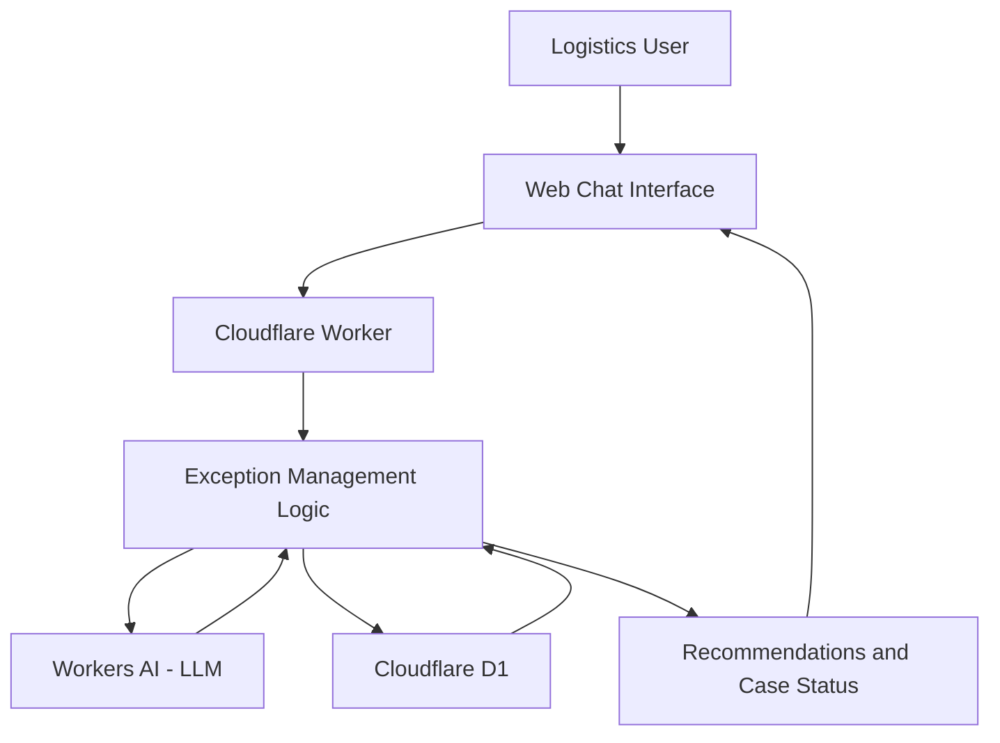

# AI Logistics Exception Management Assistant

**Status:** In Development — Initial Documentation  
**Platform:** Cloudflare Developer Platform  
**Project Type:** AI-Powered Logistics Decision Support

## Overview

The AI Logistics Exception Management Assistant is an independent
portfolio project designed to help logistics operations teams identify,
analyze, prioritize, and resolve supply chain exceptions through
AI-assisted decision support.

The project focuses on infrastructure logistics, including hardware
shipments, equipment distribution, spare parts fulfillment, and
reverse logistics.

It is being developed in response to Cloudflare's optional
AI application hiring assignment and as a demonstration of the
practical intersection between logistics operations, artificial
intelligence, and process improvement.

## Problem Statement

Logistics operations teams regularly encounter exceptions such as:

- Shipment delays and missed delivery commitments
- Missing or incomplete shipment information
- Inventory discrepancies
- Customs clearance delays
- Vendor and carrier communication issues
- Critical hardware delivery disruptions
- Reverse logistics complications

Managing these exceptions requires collecting information,
assessing operational impact, coordinating stakeholders,
and determining appropriate resolution actions.

This application aims to simplify that process through
structured AI-assisted analysis and persistent case management.

## Project Objectives

- Reduce manual exception triage effort.
- Improve consistency in operational risk assessment.
- Identify missing information and recommended next actions.
- Support escalation and stakeholder communication.
- Maintain persistent exception records and resolution history.
- Demonstrate practical AI integration within logistics operations.

## Planned Application Workflow

1. A user describes a logistics exception through a chat interface.
2. The application extracts relevant operational information.
3. The exception is classified and assessed for operational impact.
4. The AI recommends investigation and resolution actions.
5. Missing information and escalation requirements are identified.
6. The exception and its status are stored for future reference.
7. The user can revisit and update the case.

Final operational decisions remain under human control.

## Example Use Case

### Synthetic Scenario

A shipment containing critical networking equipment is delayed.
The shipment is required for a scheduled data center expansion,
and the carrier has not provided a confirmed revised delivery date.

### Expected Assistant Capabilities

- Classify the shipment exception.
- Evaluate potential operational impact.
- Identify missing shipment information.
- Recommend investigation and escalation actions.
- Generate a draft stakeholder update.
- Save the exception for ongoing monitoring.
- Retrieve the case during subsequent conversations.

This scenario is entirely fictional and does not represent
an actual Cloudflare or third-party shipment.

## Proposed Architecture

| Component | Proposed Technology |
|---|---|
| Large Language Model | Cloudflare Workers AI |
| Candidate Model | Llama 3.3 |
| Application Backend | Cloudflare Workers |
| Workflow Coordination | Cloudflare Workers |
| User Interface | Web-based Chat |
| Persistent State | Cloudflare D1 |
| Deployment | Cloudflare Developer Platform |
| Version Control | GitHub |
| AI Development History | PROMPTS.md |

Technology selections are provisional and subject to
implementation testing, platform availability, and cost limits.

## Conceptual System Architecture

## Development Roadmap

- [x] Define project objectives
- [x] Establish public GitHub repository
- [x] Complete initial project documentation
- [ ] Validate technical architecture
- [ ] Configure Cloudflare development environment
- [ ] Develop conversational user interface
- [ ] Integrate large language model
- [ ] Implement exception management workflow
- [ ] Implement persistent case storage
- [ ] Create synthetic logistics test scenarios
- [ ] Conduct functional and reliability testing
- [ ] Deploy functional MVP
- [ ] Complete technical documentation

## MVP Success Criteria

The initial application will be considered functionally
complete when it can:

- Accept a logistics exception through a chat interface.
- Generate a structured AI-assisted assessment.
- Classify the exception and recommend next actions.
- Store a case in persistent storage.
- Retrieve and update an existing case.
- Demonstrate functionality using synthetic test scenarios.
- Provide documented setup and deployment instructions.

## Data Privacy and Responsible AI

All project data will be synthetic or explicitly fictional.

This project will not use:

- Confidential employer information
- Proprietary operational procedures
- Internal corporate systems or documentation
- Real customer or shipment records
- Unauthorized third-party data

AI-generated recommendations are intended for decision support,
not autonomous operational execution.

The application will not independently contact vendors, modify
real shipments, or execute external operational actions.

## AI-Assisted Development

AI-assisted development is part of the project methodology.

Relevant development prompts, implementation decisions,
and troubleshooting interactions will be preserved in
PROMPTS.md as development progresses.

Source code, configuration, documentation, and validation
evidence will be maintained through version control.

## Cloudflare Assignment Alignment

| Assignment Component | Planned Implementation | Status |
|---|---|---|
| Large Language Model | Workers AI | Planned |
| Workflow Coordination | Cloudflare Workers | Planned |
| Chat or Voice Input | Web Chat Interface | Planned |
| Memory or State | Cloudflare D1 | Planned |
| GitHub Repository | Public Repository | Established |
| AI Prompt History | PROMPTS.md | Planned |

## Current Development Status

The project repository has been established.

Application implementation, deployment, and functional
validation are pending.

No production-ready application is currently available.

Development will prioritize a functional minimum viable
product, responsible AI usage, reproducibility, and
documented validation.

## References

- [Cloudflare Workers](https://developers.cloudflare.com/workers/)
- [Cloudflare Workers AI](https://developers.cloudflare.com/workers-ai/)
- [Cloudflare D1](https://developers.cloudflare.com/d1/)

## Disclaimer

This is an independent professional portfolio project.
It is not an official Cloudflare product and is not
affiliated with or endorsed by any current or former employer.
